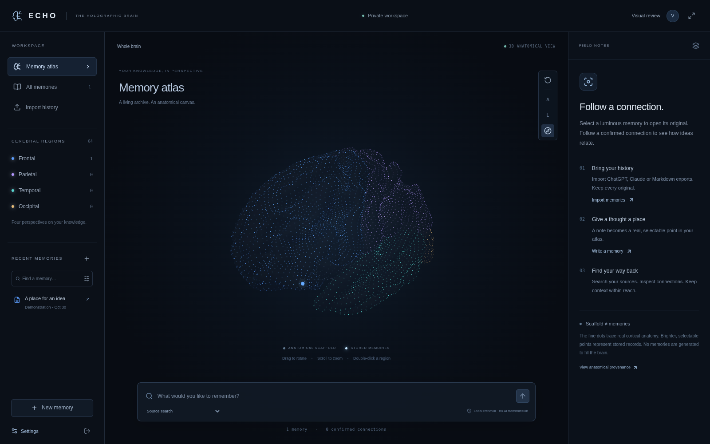

# Echo — The Holographic Brain

A working first implementation of the Holographic Brain brief: an MRI-derived,
interactive cortical atlas connected to an authenticated, persistent memory
workspace. **The full product vision is not complete.** See the precise status in
[IMPLEMENTATION.md](docs/IMPLEMENTATION.md) and the complete
[requirement roadmap](docs/ROADMAP.md).



## Run

Use Node.js 22 or newer (validated with Node 24), npm and Python 3. No API key or
external database is needed for local development.

```sh
bash scripts/setup.sh
bash scripts/start.sh
```

The development server listens on port 3000. Create your private workspace in the
app. No default account or password is installed, and no memories are seeded.
The explicitly labelled demonstration button writes one real record through the
same data layer as your notes. Repeating it does not duplicate the record.

Local PostgreSQL data lives in ignored `.data/postgres`. It survives process
restarts. Run only **one application process per PGlite data directory**. Stop
the server before running `npm run db:migrate` against that same local directory.
The server already applies migrations transactionally at first startup.

Each Codex cloud task is isolated; use this checkout rather than creating a
Git worktree unless explicitly requested.

## What works

- FreeSurfer fsaverage5 geometry: both hemispheres, preserved cortical folds,
  four atlas-derived lobe colours and a point-led holographic scaffold.
- Rotate, zoom, pan, regional focus, front/side views, memory raycasting,
  immersive view, reduced motion and graphics presets; responsive mobile layout.
- Whole brain → lobe → explicit-tag topic/project group → original, with back
  navigation, untagged records, topic search and pagination. Tag groups are not
  inferred semantic clusters. Selected sources show their actual glyph and
  confirmed neighbours even outside earlier filters.
- Accounts, opaque sessions, per-workspace access checks, persistent notes,
  immutable source versions, stable anatomical anchors and private originals.
- Official ChatGPT and Claude export imports; Markdown/text and Obsidian ZIPs.
  Conversation roles, ordering, branches and original export metadata are retained.
- Bounded, resumable import batches, archive retention/download, duplicate
  detection and retry. An identical record never creates another memory.
- Keyword and opt-in hybrid retrieval; source, region, tag and date filters;
  versioned passage citations and actual brain-node selection.
- Consent-bound embedding/summary jobs, durable progress and recovery, separate
  generated analyses, evidence-bearing semantic candidates and manual connections.
  This pipeline passes isolated mock tests; live provider quality is unverified.
- Original/source export, individual memory deletion, retained archive deletion,
  and password-confirmed account/workspace deletion.
- OpenAI Responses and Anthropic Messages adapters, explicit context consent,
  configurable model IDs, finite comparison/synthesis, usage reporting and
  saving resulting conversations. **Live API calls remain unverified**; saved
  Vercel credentials alone do not establish account/model access or answer quality.
  Adapter tests use labelled mocks.

The fine anatomical dots are not stored memories. Original source content is
never replaced by summaries. Opening previews remain extractive text,
clearly distinguished from separately stored generated analysis in the Intelligence
tab. Processing is bounded to 64 passages per original and advances while the
panel is open; it can resume later. No independent background worker is installed.

## Validate

```sh
npm run assets:verify
npm run typecheck
npm test
npm run test:e2e
npm run benchmark
npm run build
npm run test:production
```

Browser tests use system Chromium; set `CHROMIUM_PATH` if installed elsewhere.
They create an isolated local database under `/tmp/echo-browser-*`, explicitly
unset `DATABASE_URL`, and never contact AI providers. The benchmark uses an
in-memory database with isolated synthetic records, not a user's workspace.

See [VALIDATION.md](docs/VALIDATION.md) for results and limitations. Screenshots
show a test workspace and labelled demonstration/test records.

## Deployment and credentials

See [DEPLOYMENT.md](docs/DEPLOYMENT.md) and [.env.example](.env.example).
Managed deployment needs a PostgreSQL database with pgvector, certificate-verified
TLS, HTTPS hosting and a fixed `APP_ORIGIN`. API access needs separate provider
credentials and an available model ID; consumer subscriptions do not grant API
credits or access to past consumer conversations.

The local data directory is not suitable for ephemeral serverless storage.
The feature-branch preview is
https://echo-git-feat-core-memory-exploration-daniyal-1415s-projects.vercel.app.
See [DEPLOYMENT.md](docs/DEPLOYMENT.md) for its verified scope. A build or READY deployment does not certify live AI,
cloud database recovery or the full product acceptance journey.

## Design and provenance

- [Architecture and milestones](docs/ARCHITECTURE.md)
- [Anatomical source, licences and limitations](docs/ANATOMY.md)
- [Current schema and planned entities](docs/SCHEMA.md)
- [Security and data ownership](docs/SECURITY.md)
- [Implementation checkpoint and remaining work](docs/IMPLEMENTATION.md)
- [Every original requirement and its evidence](docs/ROADMAP.md)

All or portions of this licensed product (such portions are the "Software") have
been obtained under license from The General Hospital Corporation "MGH" and are
subject to the terms and conditions in
[the included FreeSurfer licence](public/licenses/FREESURFER.txt). CBIG attribution
is included in [its MIT licence](public/licenses/CBIG.txt). Anatomy is a group
average research surface, not a clinical model or a simulation of consciousness.
