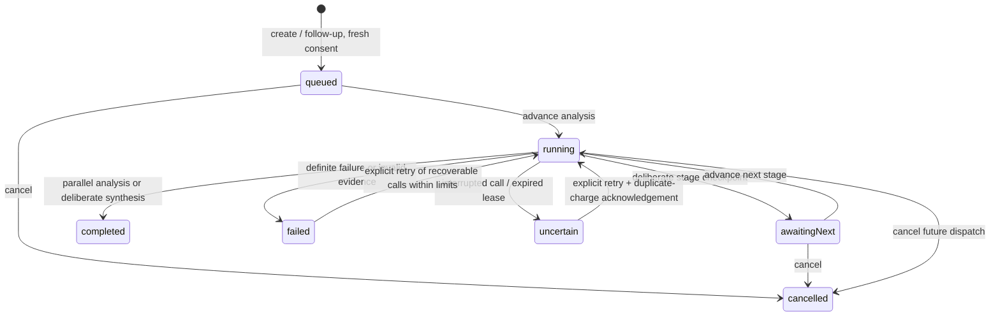

# Phase 4A collaboration API — v1

Backend implementation on `feat/phase4a-collaboration-engine`, based on
`256a036449db1e1de6a2c484a39d98258239d922`. This contract is for Claude's
frontend integration. No Phase 4 UI, deployment, hosted migration or live model
quality acceptance is claimed. Existing `/api/assistant` behavior is preserved.

## Execution model

A **thread** owns up to 100 **turns**. Each turn is a separately consented run
with a question, immutable model/limit configuration, source snapshot, bounded
prior discussion, and an append-only provider-attempt ledger. The thread belongs
to the authenticated session's workspace; clients cannot choose its workspace.

Creation retrieves context and persists `queued` without sending anything to a
provider. Each `advance` request executes **one stage** and awaits all its calls
and checkpoints. There is no background worker, automatic polling that spends
money, or dependence on promises surviving a request. GET never dispatches.

| Mode         | Stages                                                  | Normal answer requests |
| ------------ | ------------------------------------------------------- | ---------------------- |
| `parallel`   | independent OpenAI + Anthropic analysis, concurrently   | 2                      |
| `deliberate` | independent pair → cross-review pair → OpenAI synthesis | 5                      |

Both independent calls receive the same source context and prior discussion,
and neither receives the other's new answer. Each cross-review receives the
other provider's validated analysis. Synthesis receives both analyses and both
reviews. All remain available individually; synthesis does not replace them.
OpenAI is the fixed synthesizer in v1, not a third model or an adjudicated truth.



The actual JSON status is `awaiting-next-step`, not `awaitingNext`. `failed`,
`uncertain` and `cancelled` retain successful peer responses and every attempt.
A failed turn may be followed by a fresh turn; a running/queued/uncertain turn
must be finished or cancelled first. Source edits/deletion prevent subsequent
transmission/publication. Historical completed status remains historical, but
`contextCurrent=false`, `result=null` and `calls[].usable=false` prevent showing
its results as current evidence.

## Authentication and endpoints

All endpoints use the existing HttpOnly session cookie. Every mutation requires
the existing same-origin checks. JSON responses are `Cache-Control: no-store`.
`version` is always `echo-collaboration-v1`.

| Request                                | Body / query                    | Response                                               |
| -------------------------------------- | ------------------------------- | ------------------------------------------------------ |
| POST `/api/collaborations`             | TurnInput below                 | 201 thread snapshot                                    |
| GET `/api/collaborations`              | optional `before=<thread UUID>` | `{version,threads:[{id,created_at,question}]}`, max 50 |
| GET `/api/collaborations/:id`          | none                            | thread snapshot                                        |
| POST `/api/collaborations/:id/turns`   | fresh TurnInput                 | 201 thread snapshot                                    |
| POST `/api/collaborations/:id/advance` | AdvanceInput below              | 200 thread snapshot; inspect status                    |
| POST `/api/collaborations/:id/cancel`  | `{version,turnId}`              | 200 thread snapshot; idempotent                        |

Canonical input types and strict validation are in `lib/collaboration-types.ts`.
Unrecognized properties are rejected. Model IDs come from authenticated
`GET /api/settings` and must match the current configured server models exactly.
Creation does not establish provider-account access; the existing non-billable
model lookup runs before dispatch, without source text. Requested model ID is
stored on each call; actual provider-reported model is retained in its output.

```ts
type TurnInput = {
  version: 'echo-collaboration-v1';
  idempotencyKey: string; // 8–120 ASCII letters/digits/underscore/hyphen; UUID recommended
  question: string; // trimmed, 2–2000 characters
  mode: 'parallel' | 'deliberate';
  models: { openai: string; anthropic: string };
  consent: true;
  limits: {
    maxCalls: number; // integer, 2–8; at least 5 for deliberate
    maxOutputTokens: number; // integer, 128–2048, per answer request
    maxInputBytes: number; // integer, 4000–48000, per request's JSON context + instructions
  };
};
type AdvanceInput = {
  version: 'echo-collaboration-v1';
  turnId: string;
  idempotencyKey: string;
  retry?: boolean; // default false
  acknowledgePossibleDuplicateCharge?: boolean; // default false
};
```

Use one stable idempotency key for network retries of the same create/turn/step.
A reused key with a different payload returns 409. A repeated successful step
returns the current snapshot **without advancing another stage**. Use a new key
only for an intentionally new stage or explicit recovery. Never blindly retry
an uncertain operation with a fresh key.

A live lease lasts 120 seconds. Another advance during that lease cannot reserve
calls. After expiry, a new advance records the interrupted stage as `uncertain`
and returns without calling a provider. The user must then inspect it and make
a separate request with `retry:true` and
`acknowledgePossibleDuplicateCharge:true`. Reusing the original step key simply
reads its current snapshot; it is not a lease-recovery action. A late worker may
save its original attempt's result but cannot publish a stage whose lease it
lost. No exactly-once provider billing guarantee is claimed.

## Snapshot and rendering rules

Thread: `{version,id,created_at,turns}`. Turns are ordered by ordinal, bounded by 100. No server lease token, credentials or workspace selection is returned.
Important turn fields:

- `id`, `thread_id`, `ordinal`, `question`, `mode`, `config`, `prompt_version`.
- `consent_at`, `created_at`, `updated_at`, `lease_until` (display/recovery only).
- `status`, `stage` (`analysis`, `review`, `synthesis`), `error`.
- `citations`, bounded `history`, `contextCurrent`, `retrievalMode`.
- `limits`: consented limits plus `expectedCalls`, `reservedCalls`, `remainingCalls`.
- `completedStages`, `calls`, `usage`, `result`.

Each call contains `id`, `turn_id`, `stage`, `provider`, requested `model`,
`attempt`, `status`, `billing`, `retryable`, `created_at`, `finished_at`, `error`,
`output`, `result`, `usable`. Call statuses are `planned`, `dispatched`,
`completed`, `failed`, `uncertain`, `withheld`. `output` is the preserved provider
response `{provider,model,text,inputTokens,outputTokens,usageKnown?}`. `result`
is separately validated structured reasoning. **Never render raw `output.text`
as a published answer**, or interpret it as HTML. It may contain deliberately
withheld invalid citations or malicious source/model instructions.

```ts
type Reasoning = {
  groundedClaims: { text: string; citations: { source: number; quote: string }[] }[];
  interpretations: string[];
  agreements: string[];
  disagreements: string[];
  uncertainty: string[]; // at least one explicit limitation
};
```

Each array has at most eight items; strings are bounded to 1600 characters.
Canonical source references are **1-based indexes into this turn's `citations`**.
Validate/open those objects, never numbers/URLs invented inside a prose string.
A claim's quoted text must occur exactly in its selected excerpt. Speaker,
message, source-version, passage/hash and brain-node identity are inherited from
that canonical Citation, not accepted from a model. Link to the existing
`/api/memories/:id?version=<version>&passage=<chunkId>` route for indexed sources.
Unindexed sources retain exact UTF-16 start/end offsets and a content hash in
place of a chunk UUID; open their immutable version and highlight that range.
`brainNodeId` is the actual memory ID.

Use `turn.result` only when non-null. Parallel completion returns the two
independent results; deliberate completion returns its synthesis. Use
`calls[].usable` for a separately labelled partial/review view. A completed stage
is not proof that its conclusions are true. Exact quote/source validation cannot
prove entailment, speaker interpretation, consensus or completeness of criticism.
Keep interpretations, agreements, disagreements and uncertainty visible rather
than presenting agreement as verification.

## Consent, limits and recovery UX

Before starting, show both models, mode, normal call count, consented call ceiling,
per-call output limit and input-size limit. A maximum of five calls in deliberate
mode leaves no budget for additional retries; allowing up to eight is an explicit
user choice, not a default entitlement. Every reserved attempt counts toward the
ceiling, including a pre-dispatch failure. Explicit retries only send missing,
recoverable work; completed peer calls are reused. No implicit repair prompts or
automatic provider retries exist. Failed format/evidence checks require a fresh
turn instead of silently reprocessing.

`usage` reports summed recorded input/output tokens, `billingUncertain`, and
`monetaryCost:null`. Billing is `not-sent`, `unknown`, `reported` or `rejected`.
Missing usage is unknown, not a measured zero-cost request. Recovered uncertain
attempts keep their uncertainty; a successful retry cannot erase an earlier
unknown bill. Input bytes are a transmission bound, **not** a priced/tokenized
context-window guarantee. Provider costs and model context limits still need
verification before any separately authorized live acceptance run.

Cancellation prevents future stage/call dispatch. It cannot guarantee recall,
refund, or abortion of a provider request already recorded as dispatched. A
browser disconnect may leave a completed checkpoint, or an uncertain attempt
that must go through lease recovery. GET is safe for polling; never tie retries
to a polling timer. All work runs within explicit HTTP requests. Hosted request
duration (15-second metadata lookup + up to 60-second answer timeout and database
work) must be verified before release; no hosting settings were changed here.

## Context, persistence and errors

This v1 collaboration route calls existing `hybridRetrieve` with semantic sending
**disabled**: `retrievalMode='keyword-retrieval'`. It does not bill embeddings or
silently enable a paid query-index operation. Existing opt-in hybrid retrieval
elsewhere is unchanged. Collaboration semantic-query support needs a separately
accounted embedding-operation contract. No-source questions may be answered as
explicitly uncertain interpretations; they cannot contain grounded claims.

Follow-ups retrieve their own current evidence and include at most two completed
prior turns, with 4000 characters of untrusted discussion per turn. Source
provenance is revalidated transitively. Stale history or history with more than
18 source dependencies is omitted. Prior answers never become source evidence.
Context that exceeds the consented byte limit is rejected before dispatch rather
than silently losing source identity. The engine never writes generated answers
into `memory_nodes`; retries cannot create duplicate memories.

Historical source excerpts and model outputs are private collaboration snapshots.
Deleting an original invalidates their use, but does not erase that separate
history. Deleting the account/workspace cascades all collaboration records.
A per-thread delete/export UI is not implemented in Phase 4A.

HTTP errors follow the existing `{error:string}` shape: 400 invalid input/consent,
401 unsigned, 403 origin, 404 foreign/missing thread or turn, 409 conflict,
changed model/source, unsafe recovery or exhausted call allowance, 413 oversized
context, 429 application rate limit, 503 missing provider configuration, 500
sanitized persistence failure. Provider failures already checkpointed usually
return HTTP 200 with a failed/uncertain turn. Always inspect turn status, not just
HTTP success. Existing registration/authentication limits remain unchanged.
